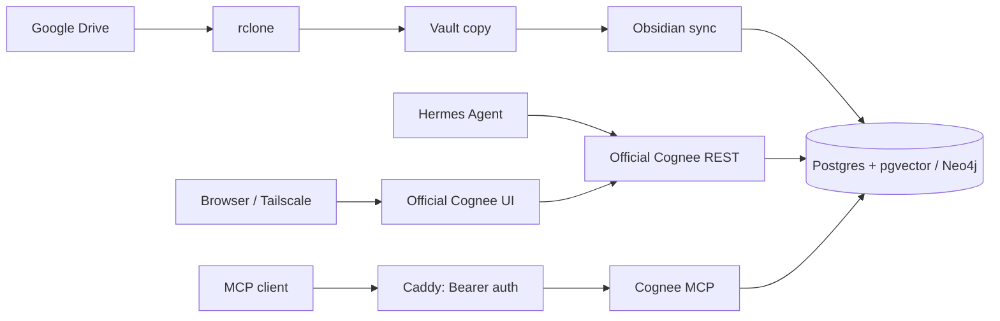

# Cognee Memory

Mac mini에서 운영하는 개인용 AI 기억 서비스입니다. Obsidian과 Hermes Agent가
같은 Cognee 저장소를 사용하고 MCP 클라이언트도 연결할 수 있습니다.

**저장은 출처별 데이터셋에, 기본 회상은 읽기 가능한 전체 데이터셋에.**



## 검증한 구성

| 항목 | 버전 / 설정 |
|---|---|
| Cognee 코어 | 1.6.7 |
| Cognee MCP | 0.5.8 |
| Hermes Cognee 플러그인 | 1.4.1 + 이 저장소의 로컬 패치 |
| 저장소 | PostgreSQL 17 + pgvector, Neo4j 5 Community |
| 세션 캐시 | PostgreSQL |
| 배포 대상 | macOS + Docker Desktop, 기본 Compose 프로젝트 `deploy` |

REST와 MCP는 별도 프로세스이며 기존 서버형 DB와 파일 볼륨을 공유합니다.
실제 코어 패키지 버전과 MCP의 serverInfo 버전은 서로 다릅니다.

## 시작하기

```bash
git clone https://github.com/kangih90/cognee-memory.git ~/cognee
cd ~/cognee
bash scripts/fetch-cognee-mcp.sh
```

고정 커밋에서 공식 MCP 소스를 받습니다. 검증 당시 로컬 Dockerfile은 이 공식
파일과 일치했습니다. 다운로드한 소스와 가상환경은 Git에 포함하지 않습니다.

1. [Docker + Drive + MCP](deploy/README.md)로 기본 서비스를 시작합니다.
2. [공식 REST + Hermes](docs/rest-hermes.md)로 같은 기억 저장소에 REST를 추가합니다.
3. 필요하면 통합 회상·출처 패치를 적용하고 새 Hermes 세션에서 검증합니다.
4. [Tailscale 전용 웹 UI](docs/private-ui.md)를 추가할 수 있습니다.

| 용도 | 기본 주소 / 데이터셋 |
|---|---|
| MCP (Tailscale 구성) | `http://127.0.0.1:18080/mcp`, Bearer 인증 |
| 공식 REST | `http://127.0.0.1:18081`, X-Api-Key 인증 |
| 웹 UI | `https://home-mini.geep-pompano.ts.net:8443`, Tailscale + 로그인 |
| Hermes 저장 | `hermes_default_memory` |
| Obsidian 저장 | `obsidian` |
| 기본 통합 회상 | 인증된 사용자가 읽을 수 있는 데이터셋 |

REST API 키와 MCP_TOKEN은 별개입니다. 공개 GitHub 저장소는 서비스의 공개
인터넷 노출을 뜻하지 않습니다. REST 포트는 호스트 loopback에만 연결합니다.

ChatGPT·Claude의 OAuth 연결은 [MCP OAuth 로그인](docs/mcp-oauth.md)을 따릅니다.
공개 MCP 주소에 OAuth를 추가하되 기존 고정 Bearer 토큰 연결도 유지합니다.

## 파일

```text
deploy/          Compose, Caddy, 비밀값 없는 설정 예시
docs/            설치·운영 안내
docs/operations/ 구성 과정과 확인된 한계에 대한 이력
scripts/         백업·검증·복구, Hermes 패치와 secret helper
sync_obsidian.py Obsidian 증분 동기화 / 검색
install_launchd.py  선택적 macOS 로컬 동기화 등록
llm_check.py     선택적 LLM 연결 확인
```

[문서 목차](docs/README.md)에서 스크립트 역할과 운영 이력을 확인할 수 있습니다.

## 로컬 파일 DB 방식 (선택)

```bash
python3 -m venv .venv
.venv/bin/pip install cognee==1.6.7
cp .env.example .env
# 편집기에서 LLM 및 볼트 경로 설정
.venv/bin/python llm_check.py
.venv/bin/python sync_obsidian.py
# 선택: 30분 간격 LaunchAgent
.venv/bin/python install_launchd.py
```

파일 DB 구성은 MCP와 동기화의 동시 접근에서 잠금 문제가 있을 수 있으므로
상시 운영에는 Docker의 서버형 DB 구성을 사용합니다.

## 데이터와 접근 범위

- 실제 .env, API 키, rclone 인증, 개인 노트, DB·모델 데이터, 백업·실행 보고는
  커밋하지 않습니다. .env.example 등은 비밀값 없는 템플릿입니다.
- 노트와 대화는 설정된 LLM 제공자에게 전송될 수 있습니다. 배포 위치와 모델
  처리 위치는 별개이며 임베딩 위치도 provider 설정을 따릅니다.
- 현재 공유 graph 모드는 물리적 사용자/데이터셋 격리를 제공하지 않습니다.
  실제 검증에서는 dataset 필터를 명시해도 다른 데이터셋 청크가 반환됐습니다.
  개인용 구성으로, 엄격한 다중 사용자 격리 용도로 사용하면 안 됩니다.
- 출처 패치는 실제 문서 ID의 소속을 검증한 결과만 데이터셋 이름으로 표시합니다.
  혼합·미확인 문맥을 활성 저장 데이터셋으로 잘못 표시하지 않습니다.
- Hermes 패치는 공식 릴리스 기능이 아닌 로컬 수정입니다. 플러그인 업데이트
  시 백업과 재적용 여부를 확인해야 합니다. 임의의 REST API를 추가하지 않습니다.
